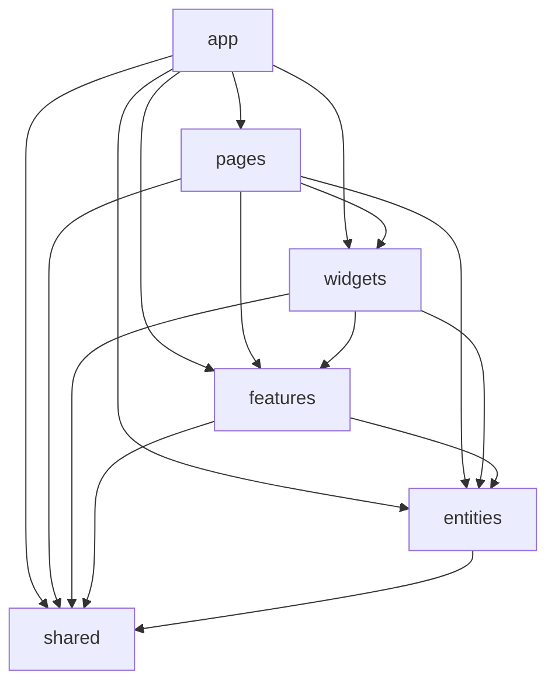
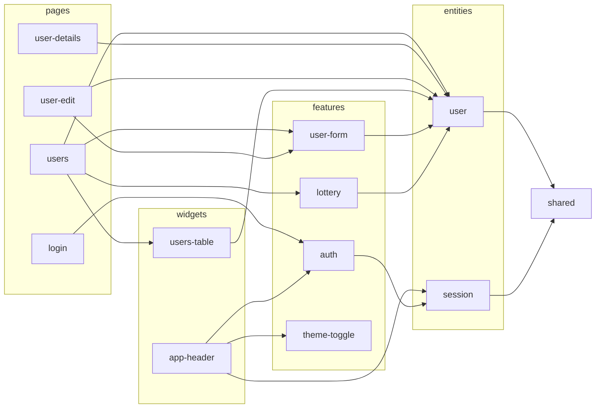

# vue-lottery-app — лабораторна робота №6

**Тема:** архітектура Feature-Sliced Design (FSD), керування станом за допомогою Pinia та
використання UI-бібліотеки компонентів.

Застосунок з лабораторної №5 (маршрутизація, користувачі DummyJSON, JWT-авторизація, Repository)
перебудовано за FSD, стан винесено в Pinia setup stores, інтерфейс зроблено на **PrimeVue**
(через обгортки в `shared/ui`). Функціонал №5 збережено без регресій.

Стек: Vue 3 + TypeScript + Composition API, Vue Router 4, Pinia (+ pinia-plugin-persistedstate),
PrimeVue 4 (тема Aura), VeeValidate + zod, SCSS, ESLint + oxlint + **Steiger** (лінтер FSD).

## Запуск

```bash
cp .env.example .env   # VITE_API_URL та інші налаштування середовища
npm install
npm run dev            # http://localhost:5173
npm run lint           # oxlint + ESLint + Steiger (правила FSD)
npm run lint:fsd       # лише Steiger
npm run build          # type-check + продакшн-збірка
npm run deploy         # публікація dist/ у гілку gh-pages
```

Тестовий акаунт DummyJSON: `emilys` / `emilyspass`.

## Структура FSD

```
src/
├── app/                         # ініціалізація застосунку
│   ├── providers/
│   │   ├── router/              # createRouter, маршрути, guard-и (meta.requiresAuth)
│   │   ├── services.ts          # реєстрація UserService і AuthService у ServiceProvider
│   │   ├── store.ts             # Pinia + pinia-plugin-persistedstate
│   │   ├── ui.ts                # PrimeVue, тема (основний колір), ToastService
│   │   └── auth-interceptor.ts  # зв'язок http-клієнта зі стором сесії (refresh при 401)
│   ├── layouts/                 # DefaultLayout, AuthLayout (meta.layout)
│   ├── styles/main.scss
│   ├── App.vue
│   └── main.ts
├── pages/                       # home, about, users, user-details, user-edit, login, not-found
├── widgets/
│   ├── app-header/              # AppHeader + AppNavigation + AppLogo
│   └── users-table/             # пошук, таблиця, пагінація, видалення з підтвердженням
├── features/
│   ├── auth/                    # LoginForm, LogoutButton, схема валідації входу
│   ├── user-form/               # UserForm (створення й редагування), CreateUserCard
│   ├── lottery/                 # переможці лотереї (store + WinnersBoard)
│   └── theme-toggle/            # світла/темна тема (store + ThemeToggle)
├── entities/
│   ├── user/                    # model (types, users.store), api (UserService)
│   └── session/                 # model (types, session.store), api (AuthService)
└── shared/
    ├── api/                     # http-client, інтерфейси Repository, ServiceProvider
    ├── ui/                      # AppButton, AppInput, AppSelect, AppTable, AppConfirmDialog, ...
    ├── lib/                     # formatDate, safeRedirect, правила валідації
    └── config/                  # API_URL, TOKEN_TTL_MINUTES з .env
```

Кожен слайс має `index.ts` (Public API). Імпорти між слайсами й шарами — лише через нього:
`import { useUsersStore } from '@/entities/user'`, а не `'@/entities/user/model/users.store'`.

### Діаграма залежностей шарів



Конкретні залежності слайсів:



### Лінтер FSD (Steiger)

`steiger.config.ts` вмикає рекомендований набір правил `@feature-sliced/steiger-plugin`. Помилками
є, зокрема, імпорт з вищого шару (`fsd/forbidden-imports`), імпорт між слайсами одного шару та
імпорт повз Public API (`fsd/no-public-api-sidestep`). Вимкнено лише дві рекомендації, що
суперечать структурі, заданій у завданні: `fsd/insignificant-slice` (слайс з одним споживачем) і
`fsd/segments-by-purpose` для `app/providers`.

## Repository у FSD

| Частина | Розташування |
|---|---|
| HTTP-клієнт, інтерфейси `Readable`, `Searchable`, `Creatable`, `Editable`, `Deletable` | `shared/api` |
| `User`, `CreateUserDto`, `UpdateUserDto` | `entities/user/model/types.ts` |
| `UserService` | `entities/user/api` |
| `AuthService` | `entities/session/api` |
| `ServiceProvider` — універсальний реєстр | `shared/api/service-provider.ts` |
| Реєстрація `UserService` і `AuthService` | `app/providers/services.ts` |

`shared` не може залежати від `entities`, тому `ServiceProvider` не імпортує конкретні сервіси:
`register(key, factory)` / `get<T>(key)`, а реєстрацію робить шар `app`. Компоненти до сервісів
напряму не звертаються — лише через стори.

## Pinia

Усі стори — **setup stores** (Composition API). У компонентах state і getters деструктуризуються
через `storeToRefs`, actions — напряму.

| Store | Слайс | Що містить |
|---|---|---|
| `useSessionStore` | `entities/session` | `accessToken`, `refreshToken`, `user`, `isAuthenticated`; `setSession`, `clearSession`, `login`, `fetchMe`, `refresh` |
| `useUsersStore` | `entities/user` | `users`, `total`, `isLoading`, `error`, `currentUser`; `fetchUsers`, `fetchUser`, `createUser`, `updateUser`, `removeUser` |
| `useLotteryStore` | `features/lottery` | `winners`; `draw`, `remove`, `canDraw` |
| `useThemeStore` | `features/theme-toggle` | `theme`, `isDark`; `toggle` |

DummyJSON лише імітує POST/PUT/DELETE, тому `useUsersStore` після успішної відповіді сам
запам'ятовує `created`, `updated`, `deletedIds` і накладає їх на кожну сторінку з API (getter `users`).
`useLotteryStore` через `$onAction` стежить за `removeUser` / `updateUser`, щоб переможці
залишалися актуальними.

### Ручне збереження vs pinia-plugin-persistedstate

| | `session.store.ts` (вручну) | `theme`, `lottery`, `users` (плагін) |
|---|---|---|
| Код | `localStorage.getItem` при створенні стану і `setItem`/`removeItem` у кожній дії | одна опція `{ persist: true }` або `{ persist: { pick: [...] } }` |
| Контроль | повний: окремі ключі `session:accessToken`, `session:refreshToken`, `session:user` | ключ = id стору, серіалізація JSON, вибір полів через `pick` |
| Ризик помилок | можна забути синхронізувати поле | мінімальний |
| Коли доречно | чутливі дані, нестандартний формат, потрібна явність | налаштування, кеш, прості дані |

## UI-бібліотека (PrimeVue)

- Компоненти імпортуються **окремо** (`import Button from 'primevue/button'`) лише в обгортках
  `shared/ui` — у бандл потрапляють тільки використані компоненти (tree-shaking).
- Обгортки: `AppButton` (кнопка й кнопка-посилання), `AppInput` (з помилкою валідації), `AppSelect`,
  `AppTable` (DataTable з серверним сортуванням і слотами комірок), `AppConfirmDialog`,
  `AppToast` + `useAppToast`, `AppPaginator`, `AppSearchInput`, `AppCard`, `AppMessage`,
  `AppSpinner`, `AppTag`, `AppChip`.
- Поза `shared/ui` і `app/providers/ui.ts` прямих імпортів PrimeVue немає.
- Тема Aura з основним кольором `#00a3dc` (`definePreset` + `palette`); темна тема — клас
  `app-dark` на `<html>` (`darkModeSelector`).
- Сповіщення (toast): користувача створено, оновлено, видалено, помилка авторизації.

## Історія комітів

```
chore: copy lab5 as the starting point for lab6
chore: add Pinia, UI library, FSD linter
refactor: introduce FSD folder structure
refactor: split Repository across FSD layers
feat: add Pinia stores
feat: add shared/ui wrappers
refactor: use wrappers and stores in pages and widgets
chore: fix FSD lint errors
refactor: remove unused localStorage helpers
docs: describe FSD structure, stores and UI library
```

## Відповіді на контрольні запитання

**1. Що таке Feature-Sliced Design і які проблеми вона вирішує?**
Методологія організації фронтенд-коду: єдині правила, де лежить код і хто від кого може залежати.
Вирішує хаос у структурі, заплутані залежності й «усе імпортує все», спрощує навігацію,
масштабування та командну роботу.

**2. Які шари виділяються у FSD? У якому порядку і чому?**
Згори вниз: `app` → `pages` → `widgets` → `features` → `entities` → `shared`. Чим вище шар, тим
більше він знає про застосунок; нижчі шари загальніші й перевикористовуються. Залежності йдуть
лише вниз, тож зміни в нижніх шарах передбачувано впливають на верхні.

**3. Головне правило імпортів між шарами? Чи може `features` імпортувати з `widgets`?**
Модуль імпортує лише з шарів, нижчих за свій. `features` з `widgets` — ні (widgets вищий),
навпаки — так.

**4. Чому слайси одного шару не імпортують один одного? Що робити зі спільним кодом?**
Інакше слайси стають зв'язаними: зміна одного ламає інший, з'являються цикли. Спільний код
опускають на нижчий шар (у `entities` чи `shared`) або об'єднують слайси на вищому шарі (сторінка
чи віджет композує обидва). Приклад: правила валідації для `features/auth` і `features/user-form`
винесено в `shared/lib/validation.ts`.

**5. Що таке слайс і сегмент? Які сегменти найчастіші?**
Слайс — поділ шару за предметною областю (`entities/user`, `features/auth`). Сегмент — поділ слайсу
за технічним призначенням: `ui`, `model`, `api`, `lib`, `config`.

**6. Що таке Public API слайса і навіщо `index.ts`?**
Явний перелік того, що слайс віддає назовні. Внутрішню структуру можна змінювати, не ламаючи
імпорти інших модулів; лінтер забороняє імпорти «вглиб».

**7. Чим відрізняються `entities` і `features`? Приклади.**
`entities` — бізнес-сутності (дані, типи, стор, API): `user`, `session`. `features` — дії
користувача, що мають цінність: вхід (`auth`), створення/редагування (`user-form`), розіграш
(`lottery`), перемикання теми (`theme-toggle`).

**8. Чому `app` і `shared` не діляться на слайси?**
`app` — одна точка ініціалізації всього застосунку, `shared` — код без бізнес-логіки. Предметних
областей у них немає, тож вони складаються одразу із сегментів.

**9. Чому `ServiceProvider` з №5 не можна залишити в `shared` і як це вирішено?**
Він імпортував `UserService` з `entities`, а `shared` не може залежати від вищого шару. Тепер це
універсальний реєстр (`register` / `get`) без імпортів з `entities`, а реєстрацію сервісів зроблено
в `app/providers/services.ts`.

**10. Що таке Pinia і чим вона відрізняється від composable зі спільним `ref`?**
Офіційна бібліотека керування станом. На відміну від модульного `ref`: один екземпляр стору на
застосунок (`app.use(pinia)`, коректно в SSR і тестах), devtools (історія змін, time travel),
плагіни (persistedstate), `$onAction`, `$reset`, чітка структура state/getters/actions.

**11. Options stores vs setup stores? Для чого `storeToRefs`?**
Options store — об'єкт `{ state, getters, actions }`; setup store — функція з `ref` (state),
`computed` (getters) і функціями (actions), як Composition API. `storeToRefs` перетворює state і
getters стору на ref-и, щоб деструктуризація не втрачала реактивність.

**12. Чому не можна напряму деструктуризувати state стору без `storeToRefs`?**
Стор — reactive-об'єкт; `const { users } = store` копіює поточне значення, і змінна більше не
оновлюється. Actions — звичайні функції, їх деструктуризувати можна.

**13. Чому до сервісів краще звертатися через Store, а не з компонентів?**
Стан (дані, `isLoading`, `error`) і логіка зберігаються в одному місці та доступні будь-якому
компоненту; не дублюються запити й обробка помилок; після CRUD стор оновлює локальний стан
(DummyJSON лише імітує запис); компоненти простіші й легше тестуються.

**14. Для чого компоненти UI-бібліотеки обгортають у `shared/ui`?**
Щоб зменшити залежність від бібліотеки: решта коду використовує `AppButton`, `AppInput` тощо,
тож заміна бібліотеки чи зміна її API зачіпає один шар. Обгортки також задають єдиний вигляд
і поведінку (наприклад, показ помилки валідації в `AppInput`).

**15. Що таке tree-shaking і як підключити лише потрібні компоненти?**
Видалення з бандлу коду, який не імпортується. Компоненти імпортують окремо
(`import Button from 'primevue/button'`) замість глобальної реєстрації всієї бібліотеки
(або через auto-import resolver).

**16. Переваги й недоліки FSD для невеликого застосунку?**
Переваги: передбачувана структура, явні залежності, перевірка лінтером, готовність до росту.
Недоліки: багато папок і `index.ts` для малого обсягу коду, слайси з одним споживачем
(Steiger про це попереджає), вищий поріг входу й більше часу на початкову організацію.
